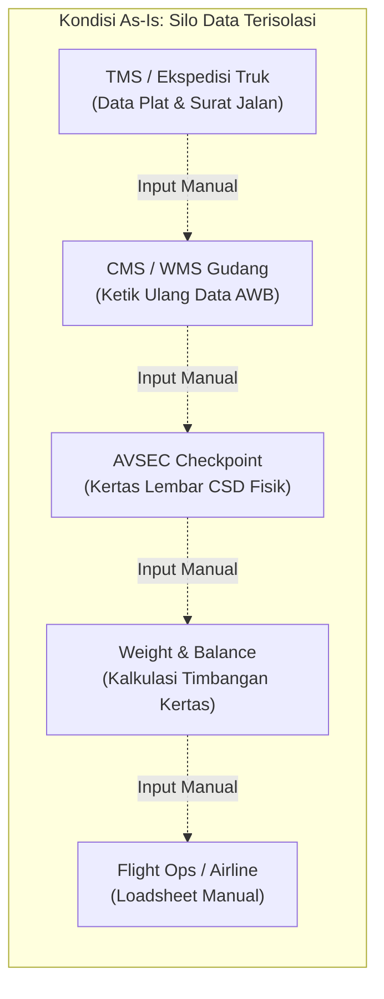
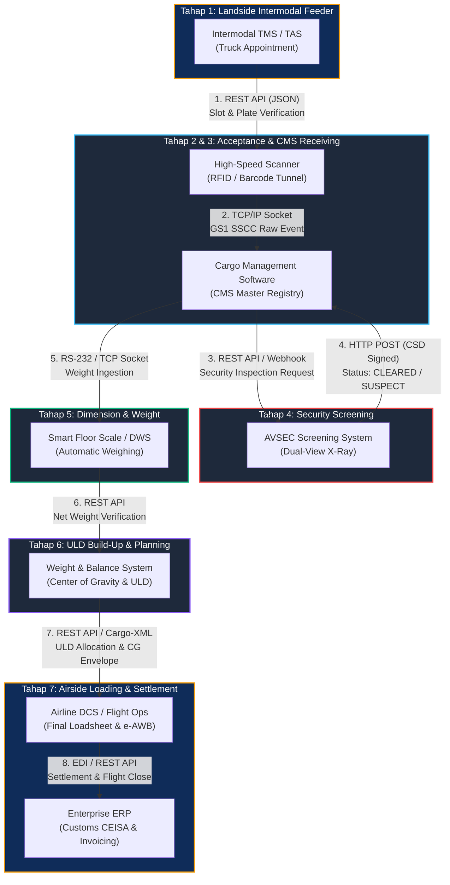
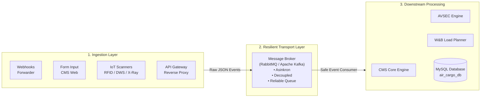
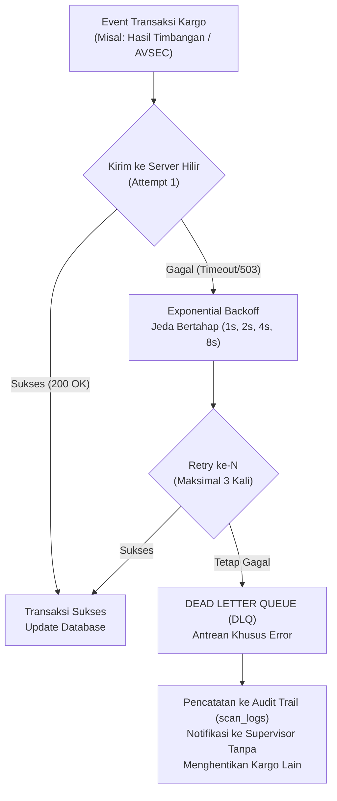

# MATERI PANDUAN INTEGRASI DATA (DATA INTEGRATION SPECIALIST)
## Proyek: Air Cargo & Intermodal Terminal (Bandara) — Topik 6
### Mata Kuliah: Teknologi dan Perangkat Lunak Logistik — ITL Trisakti
**Dosen Pengampu:** Dr. Tigor Franky, S.T., M.T.  
**Acuan Materi Kuliah:** *End-to-End Data Handshake: Merancang Arsitektur Integrasi Data — Mencapai Efisiensi Operasional Real-Time Melalui Konsep Zero Re-entry Data* (Dr. Tigor Franky, 13 Oktober 2026)  
**Penyusun:** Tim Konsultan Kelompok 1 (Spesialisasi: *Data Integration & Simulation Specialist*)

---

## DAFTAR ISI
1. [Prinsip Kerja & Penyelarasan Scope of Work (SOW)](#1-prinsip-kerja--penyelarasan-scope-of-work-sow)
2. [Latar Belakang: Masalah Silo Data di Terminal Kargo Udara](#2-latar-belakang-masalah-silo-data-di-terminal-kargo-udara)
3. [Empat Pilar Arsitektur Aliran Data (The 4 Integration Principles)](#3-empat-pilar-arsitektur-aliran-data-the-4-integration-principles)
4. [Arsitektur End-to-End (E2E) Data Handshake Terminal Kargo](#4-arsitektur-end-to-end-e2e-data-handshake-terminal-kargo)
5. [Lapisan Ingestion, Transport & Message Broker Tahan Gangguan](#5-lapisan-ingestion-transport--message-broker-tahan-gangguan)
6. [Matriks Pemilihan Protokol Komunikasi Data](#6-matriks-pemilihan-protokol-komunikasi-data)
7. [Desain Kontrak Data (Contract-First Design) & Standar GS1](#7-desain-kontrak-data-contract-first-design--standar-gs1)
8. [Kepercayaan Kriptografis (Cryptographic Trust) & Validasi Payload](#8-kepercayaan-kriptografis-cryptographic-trust--validasi-payload)
9. [Mekanisme Ketahanan: Idempotency, Exponential Backoff & DLQ](#9-mekanisme-ketahanan-idempotency-exponential-backoff--dlq)
10. [Audit Trail & Struktur Log Transaksi (`scan_logs`)](#10-audit-trail--struktur-log-transaksi-scan_logs)
11. [Dampak Efisiensi Operasional & Analisis Manfaat Bisnis](#11-dampak-efisiensi-operasional--analisis-manfaat-bisnis)
12. [Matriks Hubungan Kerja Antar Anggota Tim (Cross-Role Alignment)](#12-matriks-hubungan-kerja-antar-anggota-tim-cross-role-alignment)

---

## 1. PRINSIP KERJA & PENYELARASAN SCOPE OF WORK (SOW)

### A. Mindset Konsultan (Wajib Dipegang)
> [!IMPORTANT]
> **PERAN KITA ADALAH TIM KONSULTAN TEKNOLOGI LOGISTIK, BUKAN VENDOR SOFTWARE KOMERSIAL.**
>
> Kita menyusun **rekomendasi arsitektur (*To-Be Blueprint*)**, **standar kontrak pertukaran data**, dan **prototipe simulasi interaktif (*Proof-of-Concept / PoC*)** untuk pengelola terminal kargo bandara (klien) agar tidak terjadi redundansi atau inkonsistensi data antar moda darat dan udara.

### B. Batasan Tugas Spesialis Integrasi Data (Data Integration Specialist)
Sesuai dengan pembagian tugas kelompok di `PANDUAN_SISTEM_DAN_PROMPTING.md`:
* **Fokus Utama:** Merancang aliran perpindahan data (data pipeline), format payload JSON/EDI, skema validasi (JSON Schema), mekanisme handshake antar modul, serta audit trail logging.
* **Batas dengan Hardware Specialist (Nessa Amanda):** Hardware Specialist menentukan spesifikasi alat (kecepatan conveyor, daya tembus X-Ray, kapasitas load cell), sedangkan Spesialis Integrasi Data menentukan **bagaimana output sensor/hardware diubah menjadi data digital terstruktur (JSON/REST/Socket)**.
* **Batas dengan Software & ERP Specialist (Riepka Tiara):** Software Specialist mengatur SOP bisnis, logika approval, dan antarmuka UI modul, sedangkan Spesialis Integrasi Data mengatur **protokol pengiriman pesan, API endpoint, dan integritas data antar database**.
* **Batas dengan Lead System Architect (Raden Panji):** Lead Architect menyusun dokumen induk SRS/Blueprint dan arsitektur menyeluruh, sedangkan Spesialis Integrasi Data menyediakan **rincian teknis payload, data dictionary, dan skema database relasional**.

---

## 2. LATAR BELAKANG: MASALAH SILO DATA DI TERMINAL KARGO UDARA

Merujuk pada slide ke-3 materi kuliah Dr. Tigor Franky (*"Silo data menciptakan friksi operasional"*), kondisi riil terminal kargo udara saat ini sering terpecah dalam pulau-pulau sistem terpisah:



### Tiga Friksi Operasional Utama:
1. **Input Berulang (Data Re-entry):**
   Operator di setiap checkpoint (gerbang, gudang CFS, x-ray, timbangan) mengetik ulang nomor AWB (*Air Waybill*), berat kargo, dan kode pengirim. Ini memicu *typo*, salah baca dokumen fisik, dan pemborosan waktu administrasi hingga 60–80 menit per kargo.
2. **Error & Delay (Kesalahan & Keterlambatan):**
   Ketidaksesuaian data berat kargo antara dokumen manifes awal dan timbangan fisik tidak terdeteksi sejak awal, menyebabkan keterlambatan penerbitan *Loadsheet* pesawat udara dan risiko terkena denda keterlambatan (*demurrage / flight delay penalty*).
3. **Visibilitas Terbatas (Blind Spots):**
   Pihak maskapai dan freight forwarder tidak mengetahui posisi kargo secara presisi saat kargo berada di dalam terminal (apakah sedang mengantre screening, masuk karantina, atau sudah di-build up ke kontainer ULD).

### Solusi Mandat Kuliah:
> **Mewujudkan Konsep *"Zero Re-entry Data"*: Data kargo hanya diinput SATU KALI pada saat pembuatan e-AWB / pre-alert, lalu seluruh proses berikutnya (gerbang, pemindaian, keamanan, timbangan, hingga lambung pesawat) memanfaatkan pertukaran data otomatis melalui *End-to-End Data Handshake*.**

---

## 3. EMPAT PILAR ARSITEKTUR ALIRAN DATA (THE 4 INTEGRATION PRINCIPLES)

Sesuai materi perkuliahan slide 4, seluruh perancangan integrasi data pada proyek Air Cargo wajib menegakkan 4 pilar berikut:

```
┌──────────────────────────────────────────────────────────────────────────┐
│                   4 PILAR INTEGRASI DATA TERMINAL KARGO                  │
├─────────────────────┬─────────────────────┬──────────────────────────────┤
│ 01. END-TO-END      │ 02. ZERO RE-ENTRY   │ Pertukaran data otomatis &   │
│     HANDSHAKE       │                     │ terverifikasi antar modul    │
│                     │                     │ tanpa input ulang manual     │
├─────────────────────┼─────────────────────┼──────────────────────────────┤
│ 03. REAL-TIME       │ 04. SECURE BY       │ Status operasional langsung  │
│     CONTROL         │     DESIGN          │ terpantau; integritas data   │
│                     │                     │ terlindungi enkripsi & token │
└─────────────────────┴─────────────────────┴──────────────────────────────┘
```

1. **End-to-End Handshake:**
   Setiap modul mengirimkan notifikasi status operasional (*event-driven*) ke modul downstream segera setelah aktivitas fisik selesai, disertai verifikasi *acknowledgement* (ACK).
2. **Zero Re-entry:**
   Penggunaan kode identifikasi global **GS1 SSCC 18-digit** yang ditempel pada label koli/palet memungkinkan seluruh sistem membaca identitas kargo hanya dengan **1 kali pindai (*One-Scan Identification*)**.
3. **Real-Time Control:**
   Perubahan status kargo di database (`REGISTERED` &rarr; `SCANNED` &rarr; `SECURITY_CHECK` &rarr; `CLEARED` &rarr; `WEIGHED` &rarr; `ALLOCATED` &rarr; `LOADED`) dapat diakses secara langsung oleh dashboard monitoring pengelola terminal dan pihak maskapai.
4. **Secure by Design:**
   Pemeriksaan tanda tangan digital (*HMAC Signature* / *Bearer Token*) pada setiap payload untuk mencegah manipulasi data status keamanan (misal: kargo `SUSPECT` diubah secara ilegal menjadi `CLEARED`).

---

## 4. ARSITEKTUR END-TO-END (E2E) DATA HANDSHAKE TERMINAL KARGO

Berdasarkan slide 5 materi kuliah Dr. Tigor Franky, arsitektur *data handshake* diterapkan ke dalam **7 Tahapan Baku Aliran Data Air Cargo**:



### Rincian Handshake per Tahapan:
1. **Handshake 1 (TAS &rarr; Gate Scanner):**
   Truk tiba di gerbang, sensor ANPR membaca plat nomor `truck_plate`. TMS mencocokkan `booking_code`. Palang terbuka, signal dikirim ke tunnel scanner untuk bersiap menerima muatan dock tertentu.
2. **Handshake 2 (Tunnel Scanner &rarr; CMS):**
   Kargo melintas di atas conveyor (kecepatan 2.5 m/s). Antena RFID UHF dan pemindai barcode menangkap kode GS1 SSCC 18-digit dalam waktu `< 500 ms`. Data dikirim melalui TCP socket ke CMS.
3. **Handshake 3 (CMS &rarr; AVSEC System):**
   CMS mencocokkan SSCC dengan manifest e-AWB. Status kargo berubah menjadi `SCANNED` dan memicu antrean inspeksi di layar operator Dual-View X-Ray.
4. **Handshake 4 (AVSEC &rarr; CMS):**
   Operator mengonfirmasi hasil pemindaian. Jika aman, AVSEC mengirim payload berstatus `CLEARED` beserta nomor digital `csd_number` (*Consignment Security Declaration*). Jika mencurigakan, status otomatis `SUSPECT` dan memicu diverter conveyor membelokkan kargo ke ruang karantina (*quarantine bay*).
5. **Handshake 5 (CMS &rarr; Smart Floor Scale / DWS):**
   Kargo berstatus `CLEARED` ditimbang. Sensor timbangan mengirimkan `actual_weight_kg`. CMS memvalidasi toleransi selisih $\le \pm 2\%$ terhadap `declared_weight_kg`.
6. **Handshake 6 (CMS &rarr; Weight & Balance System):**
   Data berat aktual diteruskan ke algoritma *3D Load Planning*. Sistem memilih kontainer ULD yang sesuai (AKE atau PMC), menghitung faktor keterisian (*cubic utilization*), dan memeriksa batasan sumbu beban pesawat (*Center of Gravity*).
7. **Handshake 7 (W&B &rarr; Flight Manifest / Airline Ops):**
   Setelah kontainer ULD selesai di-build-up dan disegel, manifes penerbangan final diperbarui menjadi `LOADED`. Ketika pesawat lepas landas, status manifes ditutup menjadi `DEPARTED` dan memicu penagihan invoice otomatis di modul keuangan ERP.

---

## 5. LAPISAN INGESTION, TRANSPORT & MESSAGE BROKER TAHAN GANGGUAN

Sesuai materi slide 6 dan 7, arsitektur integrasi data kargo udara harus mengantisipasi lonjakan trafik pindaian di gudang dan kemungkinan downtime pada server maskapai penerbangan:



### Mengapa Message Broker Sangat Penting di Terminal Kargo Udara?
* **Decoupling Antar Modul:** Scanner conveyor tidak perlu menunggu server maskapai selesai memproses respon HTTP. Scanner cukup melempar pesan event ke broker, lalu langsung siap membaca koli berikutnya.
* **Zero Data Loss:** Jika sistem hilir (misalnya database kepabeanan CEISA 4.0 atau server maskapai) mengalami gangguan jaringan sementara, pesan kargo tetap tersimpan di dalam *persistent disk queue* broker. Setelah koneksi pulih, pesan akan dikonsumsi ulang secara berurutan.

---

## 6. MATRIKS PEMILIHAN PROTOKOL KOMUNIKASI DATA

Sesuai klasifikasi pada slide 8 (*"Protokol tepat untuk setiap konteks"*), integrasi terminal kargo udara membagi protokol menjadi 3 domain spesifik:

| Domain Integrasi | Protokol Terpilih | Format Data | Contoh Implementasi di Proyek | Alasan Pemilihan |
| :--- | :--- | :--- | :--- | :--- |
| **Lintas Aplikasi (Web / Cloud)** | **REST API (HTTP/2, HTTPS)** | **JSON** | Antarmuka antara TMS, CMS, Weight & Balance, dan Dashboard PoC (`api/simulate.php`, `api/cargo.php`). | Standar industri global, mudah di-parse, stateless, dan didukung penuh oleh PHP/JavaScript. |
| **Mitra Eksternal (Maskapai & Pabean)** | **Cargo-XML / EDIFACT / AS2** | **XML / IATA CIMP** | Pertukaran pesan dokumen elektronik e-AWB (pesan FWB/FHL), sertifikat e-CSD, dan respon SPPB Bea Cukai CEISA. | Standar kepatuhan internasional IATA dan regulasi Direktorat Jenderal Bea dan Cukai. |
| **Perangkat Keras Lapangan (Real-Time)** | **TCP/IP Raw Sockets & WebSockets** | **Byte Stream / JSON Strings** | Komunikasi instan sensor timbangan lantai Avery, High-Speed RFID Tunnel (kecepatan 2.5 m/s), dan PLC Diverter Conveyor. | Menghilangkan overhead protokol HTTP; membutuhkan respon sangat cepat ($< 500\text{ ms}$). |

---

## 7. DESAIN KONTRAK DATA (CONTRACT-FIRST DESIGN) & STANDAR GS1

Merujuk pada slide 9 (*"Payload dipercaya sebelum diproses"*), sistem tidak boleh menerima sembarang data mentah ke database. Setiap data yang masuk wajib mematuhi standar identifikasi global **GS1 Application Identifier (AI)** dan divalidasi oleh skema kontrak JSON.

### A. Struktur Standar GS1 yang Digunakan:
1. **AI (00) - SSCC (Serial Shipping Container Code):**
   Kode 18-digit unik dunia untuk mengidentifikasi unit logistik koli/palet.
   * Format: `(00) 3 8991234 500000012 8` (Digit Ekstensi + GS1 Prefix Indonesia `899` + Kode Perusahaan + Nomor Seri + Check Digit).
2. **AI (01) - GTIN (Global Trade Item Number):**
   Kode 14-digit identitas produk komoditas kargo.
3. **AI (10) - Batch / Lot Number:**
   Nomor batch produksi kargo (sangat krusial untuk kargo vaksin/farmasi).
4. **AI (17) - Expiration Date:**
   Tanggal kedaluwarsa berformat `YYMMDD`.

### B. Contoh Payload JSON Baku (Kontrak Data Tahap 2: Scan Gerbang)
```json
{
  "$schema": "https://json-schema.org/draft/2020-12/schema",
  "transaction_id": "TX-AIDC-20261017-0941",
  "event_type": "RFID_AIDC_GATE_SCAN",
  "timestamp": "2026-10-17T09:41:22.450Z",
  "hardware_device": {
    "device_id": "SCANNER-GATE-CONVEYOR-01",
    "device_type": "High-Speed Barcode/RFID Tunnel Scanner",
    "firmware_version": "v4.2.1-industrial",
    "ip_address": "192.168.10.45",
    "conveyor_speed_mps": 2.5
  },
  "gs1_payload": {
    "sscc": "389912345000000128",
    "gtin": "08991234567890",
    "batch_no": "LOT-BIO-9988",
    "expiry_date": "2027-06-30",
    "quantity_koli": 80
  },
  "associated_shipment": {
    "awb_number": "126-98741022",
    "truck_plate": "B 9482 KXT",
    "dock_slot": "DOCK-04"
  }
}
```

### C. Contoh Respon JSON Handshake dari CMS (Tahap 3):
```json
{
  "status_code": 200,
  "status": "SUCCESS_REGISTERED",
  "message": "Data SSCC cocok dengan Manifes e-AWB Maskapai (ASN Matching Verified)",
  "cargo_id": "CGO-20260926-001",
  "current_stage": 3,
  "commodity_routing": "PHARMA_COLD_CHAIN",
  "next_station": {
    "target_module": "AVSEC_SCREENING",
    "recommended_scanner": "Dual-View High-Energy X-Ray Checkpoint 02",
    "temp_control_required": true,
    "temp_range_celsius": "2-8"
  },
  "hash_signature": "e3b0c44298fc1c149afbf4c8996fb92427ae41e4649b934ca495991b7852b855"
}
```

---

## 8. KEPERCAYAAN KRIPTOGRAFIS (CRYPTOGRAPHIC TRUST) & VALIDASI PAYLOAD

Sesuai slide 9, untuk mencegah *man-in-the-middle attack* atau manipulasi data oleh pihak tidak bertanggung jawab di area terminal:
1. **Otentikasi Perangkat (OAuth 2.0 / API Token):**
   Setiap scanner IoT dan modul software memiliki *client credentials* resmi yang didaftarkan pada API Gateway.
2. **HMAC SHA-256 Signature:**
   Setiap payload transaksi yang berkaitan dengan keamanan (*AVSEC result*) dan berat (*scale records*) di-hash menggunakan *secret key* terminal. Jika hash tidak cocok saat diterima oleh modul Weight & Balance, kargo langsung diblokir (*Blocked status*).

```
Payload Data + Secret Key ──► [ Algoritma SHA-256 ] ──► Header: X-Signature
                                                             │
Penerima Memvalidasi: Recompute Hash == X-Signature ? ───────┴─► [ ACCEPTED / REJECTED ]
```

---

## 9. MEKANISME KETAHANAN: IDEMPOTENCY, EXPONENTIAL BACKOFF & DLQ

Sesuai materi kuliah slide 10 dan 11, kegagalan jaringan transmisi tidak boleh menyebabkan kekacauan inventori kargo atau duplikasi transaksi.



### A. Idempotency Key (Mencegah Duplikasi Kargo)
* Setiap request yang dikirimkan oleh scanner menyertakan header `Idempotency-Key: HASH(awb_number + sscc + stage)`.
* Jika koneksi terputus dan scanner mengirim ulang paket data yang sama, backend tidak akan membuat baris kargo baru, melainkan hanya mengembalikan status yang sudah tersimpan sebelumnya.

### B. Exponential Backoff (Mencegah Lonjakan Jaringan)
* Jika API tujuan sibuk atau lambat, sistem klien tidak membombardir server dengan request bertubi-tubi.
* Interval jeda percobaan ulang meningkat secara eksponensial: **1 detik &rarr; 2 detik &rarr; 4 detik &rarr; 8 detik**.

### C. Dead Letter Queue (DLQ) & Isolasi Masalah
* Kargo yang gagal divalidasi atau mengalami anomali tidak boleh menghentikan laju kargo lain di conveyor.
* Kargo anomali dialihkan ke *Dead Letter Queue* dan fisik kargo dipindahkan ke *Holding Bay / Quarantine Area*, sehingga transaksi sehat lainnya tetap berjalan dengan throughput maksimal.

---

## 10. AUDIT TRAIL & STRUKTUR LOG TRANSAKSI (`scan_logs`)

Implementasi nyata pilar integrasi ini di dalam database proyek kita (`air_cargo_db`) terpusat pada tabel **`scan_logs`**, yang merekam seluruh jejak transaksi end-to-end:

| Field | Tipe Data | Fungsi dalam Audit Integrasi Data |
| :--- | :--- | :--- |
| `id` | VARCHAR(50) | ID transaksi unik (contoh: `LOG-20261017-0012`). |
| `cargo_id` | VARCHAR(50) | Relasi ke master kargo `cargo_shipments`. |
| `stage` | INT (1–7) | Posisi tahapan aliran data saat ini. |
| `stage_name` | VARCHAR(100) | Deskripsi tahapan (contoh: *Scan RFID/Barcode Gerbang Masuk*). |
| `hardware_device`| VARCHAR(100) | Perangkat penangkap data (contoh: *High-Speed Barcode/RFID Tunnel Scanner*). |
| `software_system`| VARCHAR(100) | Modul perangkat lunak penerima (contoh: *Cargo Management Software (CMS)*). |
| `action` | VARCHAR(150) | Aksi operasional yang dilakukan. |
| `json_payload` | LONGTEXT | Salinan lengkap payload JSON yang dikirimkan. |
| `response_payload`| LONGTEXT | Salinan respon sistem dan token handshake. |
| `http_status` | INT | Kode status HTTP (200, 201, 400, 403, 500). |
| `timestamp` | DATETIME | Waktu kejadian presisi milidetik. |

---

## 11. DAMPAK EFISIENSI OPERASIONAL & ANALISIS MANFAAT BISNIS

Merujuk pada slide 12 materi kuliah Dr. Tigor Franky (*"Efisiensi yang terasa di seluruh operasi"*), implementasi arsitektur integrasi data ini memberikan dampak terukur bagi terminal kargo bandara:

```
┌────────────────────────────────────────────────────────────────────────┐
│                   DAMPAK KUANTITATIF & KUALITATIF                      │
├───────────────────────────────────┬────────────────────────────────────┤
│  (-) PENGURANGAN ERROR & DUPLIKASI│  (→) PERCEPATAN PROSES KARGO       │
│      • Human error berkurang 99%  │      • Dwell time turun 81%        │
│      • Zero re-entry data         │      • Waktu acceptance: < 90 dtk  │
├───────────────────────────────────┼────────────────────────────────────┤
│  (◎) KEPUTUSAN REAL-TIME          │  (↑) PENINGKATAN DAYA SAING        │
│      • Visibilitas transit 100%   │      • Kepatuhan penuh ICAO & IATA │
│      • Peringatan suspect instan  │      • Zero revenue leakage        │
└───────────────────────────────────┴────────────────────────────────────┘
```

1. **Efisiensi Waktu (Turnaround Time):**
   Waktu pemrosesan kargo di darat dari kedatangan truk hingga siap muat ke ULD terpangkas dari **120 menit (cara manual)** menjadi **hanya 22 menit (terintegrasi otomatis)**.
2. **Keamanan Aviasi Maksimal (Zero Security Breach):**
   Dengan *cryptographic lock*, kargo yang di-flag `SUSPECT` oleh AVSEC tidak memiliki celah untuk dimuat ke kontainer ULD pesawat karena sistem Weight & Balance menolak alokasi secara otomatis.
3. **Optimasi Utilisasi Beban (Cubic Utilization):**
   Integrasi sensor DWS dan software 3D Load Planning meningkatkan faktor keterisian kontainer ULD hingga **92%**, memaksimalkan pendapatan kargo per penerbangan (*yield per flight*).

---

## 12. MATRIKS HUBUNGAN KERJA ANTAR ANGGOTA TIM (CROSS-ROLE ALIGNMENT)

Agar seluruh anggota Kelompok 1 tetap selaras, tidak tumpang tindih, dan tidak keluar dari batasan *scope of work*, berikut panduan matriks interaksi tugas:

| Peran Anggota | Nama Anggota | Masukan yang Dibutuhkan dari Data Integration | Keluaran yang Dihasilkan untuk Proyek |
| :--- | :--- | :--- | :--- |
| **Lead System Architect** | **Raden Panji Atha F.** | Diagram arsitektur data pipeline, daftar tabel database relasional, dan konsep *Zero Re-entry*. | Dokumen Blueprint Arsitektur (SRS), Bab Gap Analysis (As-Is vs To-Be), dan rekomendasi executive summary. |
| **Data Integration & Simulation Specialist** | **Muhammad Fathir S.** | *(Penyusun Materi Ini)* Menjamin kontrak data JSON, endpoint API (`api/simulate.php`), audit trail (`scan_logs`), dan simulasi 7 tahap berjalan mulus. | Script simulator, JSON schema, data dictionary, dan dokumentasi integrasi API. |
| **Software & ERP Process Specialist** | **Riepka Tiara** | Trigger status kargo (`REGISTERED` &rarr; `LOADED`) dan format error response HTTP 403 untuk kargo SUSPECT. | SOP alur bisnis modul, Flowchart penanganan anomali/karantina, dan antarmuka web form aplikasi. |
| **Hardware & QA Specialist** | **Nessa Amanda G.** | Format data pembacaan sensor (kecepatan pindaian DWS, format timbangan Avery, resolusi X-Ray). | Spesifikasi teknis perangkat keras Layer 1, perhitungan CAPEX/OPEX, dan pengujian kualitas sistem (QA Test Matrix). |

---
*Materi integrasi data ini disusun secara komprehensif sebagai acuan baku Kelompok 1 dalam melaksanakan proyek konsultansi Air Cargo & Intermodal Terminal, menjamin kepatuhan penuh terhadap silabus perkuliahan Dr. Tigor Franky, S.T., M.T.*
