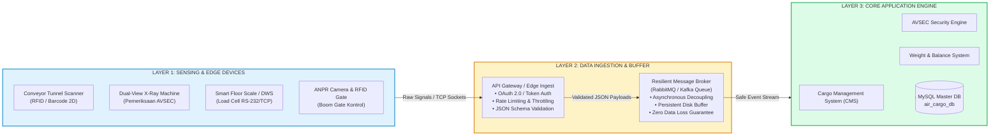
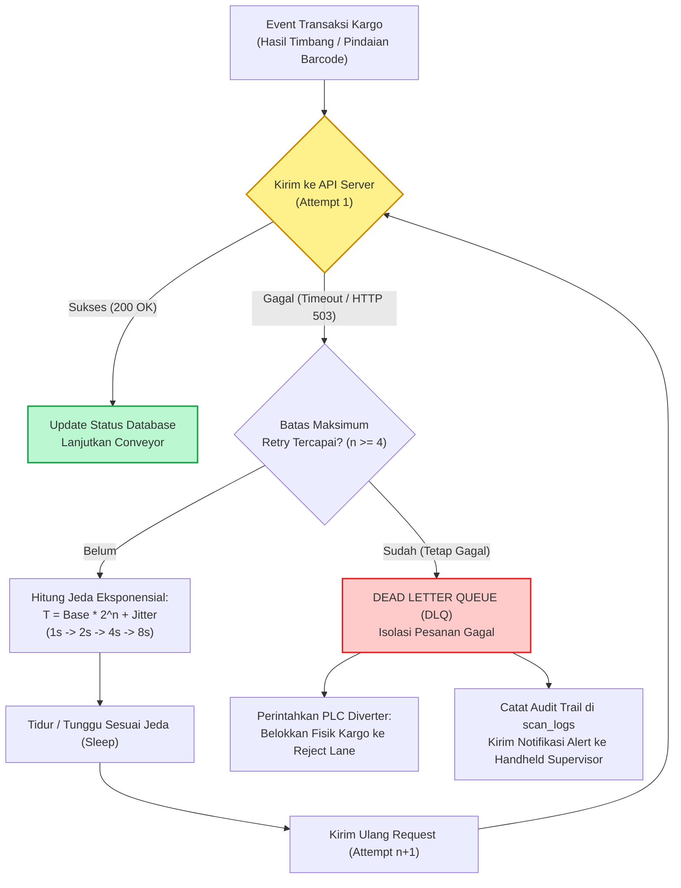

# PANDUAN DAN MATERI KISI-KISI LENGKAP UJIAN TENGAH SEMESTER (UTS)
## MATA KULIAH: TEKNOLOGI DAN PERANGKAT LUNAK LOGISTIK
**Dosen Pengampu:** Dr. Tigor Franky, S.T., M.T.  
**Program Studi:** S1 Logistik — Institut Transportasi dan Logistik (ITL) Trisakti  
**Konteks Proyek Akhir:** Topik 6 — *Air Cargo & Intermodal Terminal (Bandara)* — Kelompok 1  
**Penyusun:** Tim Konsultan Teknologi Logistik Kelompok 1  
**Format Dokumen:** Bahan Pembelajaran & Acuan Ujian Resmi  

---

## DAFTAR ISI
1. [BAGIAN I: SOAL KONSEPTUAL](#bagian-i-soal-konseptual)
   - [Nomor 1: Silo Data vs Ekosistem Terintegrasi](#1-silo-data-vs-ekosistem-terintegrasi)
   - [Nomor 2: Konsep Zero Re-entry Data](#2-konsep-zero-re-entry-data)
   - [Nomor 3: Tahap Ingestion Layer](#3-tahap-ingestion-layer)
2. [BAGIAN II: CASE STUDY](#bagian-ii-case-study)
   - [Nomor 4: Studi Kasus Alur Data Handshake (End-to-End)](#4-studi-kasus-alur-data-handshake-end-to-end)
   - [Nomor 5: Mekanisme Ketahanan Sistem: Idempotency](#5-mekanisme-ketahanan-sistem-idempotency)
   - [Nomor 6: Strategi Penanganan Kegagalan: Exponential Backoff](#6-strategi-penanganan-kegagalan-exponential-backoff)
3. [MATRIKS SINTESIS & REFERENSI SUMBER](#matriks-sintesis--referensi-sumber)

---

# BAGIAN I: SOAL KONSEPTUAL

---

## 1. Silo Data vs Ekosistem Terintegrasi

### A. Konsep Fundamental & Landasan Teori
Dalam rantai pasok modern, kecepatan dan keandalan aliran fisik kargo berbanding lurus dengan kelancaran aliran informasi digitalnya (*information flow precedes physical flow*).
* **Silo Data (*Isolated Information Islands*):**  
  Kondisi arsitektur warisan (*legacy*) di mana setiap departemen, mitra logistik, dan modul aplikasi menyimpan dan mengelola basis data secara mandiri tanpa saluran integrasi terotomasi. Data yang tersimpan terkurung dalam "silo" masing-masing, sehingga perpindahan data antar entitas harus dijembatani melalui proses manual, dokumen kertas, email, atau pengetikan ulang oleh staf operasional.
* **Ekosistem Terintegrasi (*Connected Logistics Ecosystem*):**  
  Arsitektur sistem berbasis *Single Source of Truth* (SSoT) di mana seluruh perangkat keras (*sensing devices*), modul internal (TMS, CMS, AVSEC, W&B), serta sistem mitra eksternal (maskapai penerbangan, ekspedisi darat, sistem kepabeanan nasional) saling bertukar informasi secara instan (*event-driven*) melalui standar pertukaran data terbuka (RESTful API, WebSockets, Message Broker).

```
┌────────────────────────────────────────────────────────────────────────────────────────┐
│                        KOMPARASI: SILO DATA VS EKOSISTEM TERINTEGRASI                  │
├─────────────────────┬─────────────────────────────────┬────────────────────────────────┤
│ Dimensi Komparasi   │ Paradigma Silo Data (As-Is)     │ Ekosistem Terintegrasi (To-Be) │
├─────────────────────┼─────────────────────────────────┼────────────────────────────────┤
│ Aliran Informasi    │ Terputus-putus (*Batch / Delay*)│ Mengalir Instan (*Real-Time*)  │
│ Input Data          │ Berulang di tiap pos/checkpoint │ Cukup 1 kali (*Zero Re-entry*) │
│ Visibilitas Kargo   │ Terbatas / *Blind Spots*        │ Lacak Posisi 100% Real-Time    │
│ Human Error Rate    │ Tinggi (~8.5% saltik/typo)      │ Hampir Nol (<0.02%)            │
│ Waktu Penerimaan    │ 60–90 menit per kargo           │ < 90 detik per palet           │
│ Validasi Dokumen    │ Kertas fisik mudah dipalsukan   │ Kriptografis (Digital Tokens)  │
│ Skalabilitas        │ Sulit diperluas (*Monolithic*)  │ Terdesentralisasi (*Decoupled*)│
└─────────────────────┴─────────────────────────────────┴────────────────────────────────┘
```



```mermaid
flowchart TD
    subgraph SILO["KONDISI AS-IS: FRANSI OPERASIONAL SILO DATA"]
        direction LR
        S_TRUCK["TMS Truk Feeder\n(Surat Jalan Kertas)"] -. Input Manual .-> S_CMS["CMS Gudang\n(Ketik Ulang AWB)"]
        S_CMS -. Input Manual .-> S_SEC["AVSEC Sinar-X\n(Form Fisik CSD)"]
        S_SEC -. Input Manual .-> S_WGT["Timbangan\n(Catat di Kertas)"]
        S_WGT -. Input Manual .-> S_AIR["Flight Ops\n(Loadsheet Manual)"]
    end

    subgraph INTEGRATED["KONDISI TO-BE: EKOSISTEM TERINTEGRASI AIR CARGO"]
        direction LR
        I_TRUCK["Gate TAS/TMS\n(RFID/ANPR)"] == REST API / JSON ==> I_CMS["CMS Master Registry\n(e-AWB Matching)"]
        I_CMS == Event Broker ==> I_SEC["AVSEC Screening\n(Dual-View X-Ray)"]
        I_SEC == Digital e-CSD ==> I_WGT["Smart DWS Scale\n(Load Cell Socket)"]
        I_WGT == W&B Payload ==> I_AIR["Airline DCS / ERP\n(3D Loadsheet Final)"]
    end

    style SILO fill:#FFF5F5,stroke:#E53E3E,stroke-width:2px
    style INTEGRATED fill:#F0FDF4,stroke:#16A34A,stroke-width:2px
```

### B. Tiga Friksi Operasional Akibat Silo Data di Terminal Kargo Udara
1. **Redundansi & Kesalahan Input Berulang (*Data Transcription Error*):**  
   Nomor Air Waybill (AWB 11 digit) dan kode identifikasi palet diketik berulang kali di pos gerbang darat, meja penerimaan gudang, mesin inspeksi X-Ray, dan timbangan. Kesalahan pengetikan satu digit saja memicu ketidakcocokan manifes (*manifest discrepancy*), membatalkan penerbangan kargo, atau salah kirim bandara tujuan.
2. **Keterlambatan Penerbitan Loadsheet & Risiko Denda (*Flight Delay Penalty*):**  
   Data berat aktual timbangan yang dicatat di kertas kerja fisik membutuhkan waktu lama untuk direkonsiliasi dengan kalkulasi *Weight & Balance* pesawat. Keterlambatan loadsheet 15 menit dapat menghilangkan slot waktu lepas landas (*take-off slot*) maskapai dan menimbulkan denda *demurrage*.
3. **Ketiadaan Visibilitas Lintas Moda (*Intermodal Blind Spots*):**  
   Pengelola terminal bandara tidak mengetahui secara pasti posisi truk kontainer yang sedang menuju bandara. Akibatnya, pintu bongkar muat (*dock door*) dialokasikan secara serampangan, menimbulkan antrean armada di pelataran (*yard congestion*) dan lonjakan *dwelling time*.

### C. Implementasi pada Proyek Air Cargo Kelompok 1
Dalam proyek kita, batasan silo data dieliminasi melalui integrasi 4-Layer IT Logistik:
* **Penyatuan Skema Basis Data:** Terintegrasi di `air_cargo_db` dengan tabel relasional yang saling mengunci status kargo: `truck_arrivals` &rarr; `cargo_shipments` &rarr; `security_checks` &rarr; `weight_records` &rarr; `uld_containers` &rarr; `flight_manifests`.
* **Audit Trail Transparan:** Seluruh perpindahan status kargo direkam dalam tabel `scan_logs` yang mencatat detail perangkat keras, software penerima, payload JSON, dan kode status respons HTTP secara kronologis.

---

## 2. Konsep Zero Re-entry Data

### A. Definisi & Filosofi Dasar
> **Prinsip Zero Re-entry Data:** Suatu kondisi arsitektur di mana data atribut logistik (nomor pengenal, deskripsi barang, berat, dimensi, pengirim, penerima, sertifikasi keamanan) **hanya di-input atau dicatat SATU KALI SAJA di titik inisiasi hulu (*Single Entry Point*)**, kemudian seluruh tahapan operasional berikutnya di hilir memanfaatkan pertukaran data otomatis melalui pemindaian terstandarisasi tanpa adanya pengetikan ulang manual oleh staf operasional.

```
Shipper / Pre-Alert ──► [ 1 KALI INPUT DATA ]
                              │
       ┌──────────────────────┼──────────────────────┬──────────────────────┐
       ▼                      ▼                      ▼                      ▼
  Truk Tiba              Tunnel Scanner         Screening AVSEC        Load Planning ULD
(Pindai SSCC)          (Validasi Manifes)       (Auto-Release CSD)     (Kalkulasi Otomatis)
```

### B. Enabler Utama (Teknologi Pengungkit)

1. **Standar Identifikasi Global GS1 Application Identifier (AI):**
   * **AI (00) - SSCC (*Serial Shipping Container Code*):** Nomor unik 18-digit yang menjadi **"Paspor Palet / Unit Muatan"**. SSCC berperan sebagai *Primary Key* global yang mengaitkan paket fisik kargo dengan manifes elektronik di WMS/CMS.
   * **AI (01) - GTIN (*Global Trade Item Number*):** Kode 14-digit identitas jenis/varian komoditas produk.
   * **AI (10) - Batch / Lot Number:** Identifikasi batch produksi (kritis untuk kargo vaksin/farmasi).
   * **AI (17) - Expiration Date:** Batas kedaluwarsa berformat `YYMMDD`.

```
Anatomi SSCC 18-Digit:
 (00)  3  8991234  500000012  8
 ──┬─  ┬  ───┬───  ────┬────  ┬
   │   │     │         │      └─ Modulo-10 Check Digit (Validasi Integritas Pindai)
   │   │     │         └──────── Nomor Seri Unik Unit Logistik
   │   │     └────────────────── GS1 Company Prefix (Indonesia = 899)
   │   └──────────────────────── Extension Digit (Alokator Rentang Penomoran)
   └──────────────────────────── Application Identifier (00 = Bidang SSCC)
```

2. **Perangkat AIDC (*Automatic Identification and Data Capture*):**
   * **High-Speed RFID UHF & Barcode Tunnel Scanner:** Memindai label kode batang GS1-128 / QR 2D dan tag RFID EPC Gen2 (865–928 MHz) secara instan saat kargo bergerak di konveyor dengan kecepatan 2.5 m/s. Waktu tangkap $< 500\text{ ms}$ dengan akurasi 99.98%.
   * **Dynamic Dimensioning & Weighing System (DWS):** Sensor laser optik dan load cell membaca dimensi volumetrik dan bobot riil secara simultan *on-the-fly*.

3. **e-AWB (*Electronic Air Waybill*) & One-Scan ASN Matching:**
   Pemberitahuan manifes elektronik dikirimkan oleh agen pengirim via API. Begitu koli melewati scanner di pintu masuk terminal, sistem CMS secara instan mencocokkan kode SSCC dengan manifes (*Advance Shipping Notice / ASN Matching*). Kargo langsung berstatus *Received* tanpa membuka dokumen fisik.

### C. Dampak Terukur pada Proyek Air Cargo
* **Turnaround Time Terpangkas 81.3%:** Waktu proses dari kedatangan truk hingga siap muat ke ULD turun dari **80 menit menjadi 15 menit**.
* **Penurunan Human Error hingga 99.8%:** Menghapus kesalahan transkripsi nomor resi AWB dan penulisan berat timbangan.
* **Integritas Berat Nyata:** Mencegah praktik kecurangan deklarasi muatan (*under-declared weight*) yang membahayakan keselamatan penerbangan.

---

## 3. Tahap Ingestion Layer

### A. Definisi & Posisi Arsitektur
**Ingestion Layer (Lapisan Penyerapan Data)** adalah pintu gerbang awal (*entry point*) arsitektur data terminal logistik. Lapisan ini bertugas menyerap, menyaring, mengonversi sinyal fisik mentah dari ribuan perangkat tepi (*edge devices*), serta memvalidasi struktur data sebelum diteruskan ke mesin logika aplikasi (*core application engine*).

Dalam **Arsitektur 4-Layer IT Logistik**:
1. *Layer 1 (Sensing & Data Capture):* Hardware fisik (Scanner Tunnel, Mesin X-Ray, Sensor Timbangan, RFID).
2. **Layer 2 (Network & Ingestion Layer):** Gateway transmisi, penyerapan data, penyangga asinkron (*buffer*), dan validasi kontrak skema.
3. *Layer 3 (Application & Execution Engine):* CMS Master, Modul AVSEC, Weight & Balance, WMS.
4. *Layer 4 (Data Integration Hub):* Pertukaran pesan Cargo-XML ke Airline DCS dan Bea Cukai CEISA 4.0.



### B. Tiga Fungsi Utama Ingestion Layer
1. **Mediasi Protokol (*Protocol Adapter*):**  
   Perangkat keras lapangan menghasilkan protokol yang berbeda-beda: timbangan menggunakan serial RS-232, scanner terowongan menggunakan *Raw TCP Socket*, dan kamera ANPR menggunakan stream IP RTSP. Ingestion layer mengonversi seluruh aliran byte mentah tersebut menjadi format digital terstruktur (*Canonical JSON Payload*).
2. **Penyangga Asinkron (*Message Broker Decoupling*):**  
   Dengan menempatkan Message Broker (seperti RabbitMQ atau Kafka) di Ingestion Layer, sensor pemindai konveyor tidak perlu menunggu database aplikasi selesai memproses data. Scanner melemparkan event ke antrean broker dalam hitungan milidetik, lalu siap memindai koli berikutnya tanpa ada waktu menganggur (*no blocking latency*).
3. **Peredam Lonjakan Trafik (*Surge & Spike Buffering*):**  
   Pada saat jam sibuk (*peak hours*), ratusan kargo melintas di konveyor secara simultan. Ingestion Layer menyimpan lonjakan pesan dalam antrean persisten (*disk queue*). Jika server database hilir melambat atau mati sejenak, data transaksi tetap aman dan tidak akan hilang (*Zero Data Loss Guarantee*).

### C. Desain Kontrak Data (Contract-First JSON Validation)
Sebelum payload diizinkan masuk ke database, Ingestion Layer mengevaluasi struktur data menggunakan *JSON Schema*. Contoh payload baku pada Tahap 2 Ingestion Gerbang Masuk:

```json
{
  "$schema": "https://json-schema.org/draft/2020-12/schema",
  "transaction_id": "TX-AIDC-20261017-0941",
  "event_type": "AIDC_INBOUND_JSON_INGEST",
  "device_id": "EDGE-AIDC-SCANNER-01",
  "stream_protocol": "GS1_DIGITAL_LINK_JSON / REST_MQTT",
  "edge_telemetry": {
    "conveyor_speed": "2.5 m/s",
    "carrier_freq": "865.7 MHz (EPC Gen2)",
    "confidence": "99.98%"
  },
  "gs1_data": {
    "ai_00_sscc": "389912345000000128",
    "ai_01_gtin": "08991204412993",
    "ai_10_batch_no": "LOT-ELC-4412",
    "ai_17_expiry_date": "2027-10-31",
    "quantity_koli": 60,
    "declared_weight_kg": 420.0
  },
  "ingested_at": "2026-10-17T09:41:22.450Z"
}
```

---

# BAGIAN II: CASE STUDY

---

## 4. Studi Kasus Alur Data Handshake (End-to-End)

### A. Skenario Operasional Kasus Riil
Pada proyek konsultansi terminal bandara kita, aliran kargo intermodal darat-ke-udara dijalankan melalui **7 Tahapan Baku Aliran Data (*The Unbreakable 7 Stages*)**:

```mermaid
sequenceDiagram
    autonumber
    participant TRK as Truk / Gate TAS
    participant SCN as Tunnel Scanner AIDC
    participant CMS as Cargo Management System
    participant SEC as AVSEC X-Ray System
    participant WGT as Smart Floor Scale
    participant WB as Weight & Balance System
    participant AIR as Airline Ops / Loadsheet

    Note over TRK,SCN: Tahap 1 & 2: Landside Ingestion
    TRK->>CMS: Check-in Kedatangan Truk (ANPR Plat & Booking Slot)
    CMS-->>TRK: 200 OK (TAS-Token, Pintu Dock Dialokasikan)
    SCN->>CMS: Raw Ingest Pindaian GS1 SSCC 18-Digit (TCP/JSON)
    
    Note over CMS,SEC: Tahap 3 & 4: Acceptance & Security Screening
    CMS->>CMS: ASN Matching (Pencocokan SSCC ke Manifes e-AWB)
    CMS->>SEC: Request Inspeksi Keamanan (Payload e-AWB)
    alt Kargo AMAN (CLEARED)
        SEC->>CMS: Screening Lolos (HTTP 200, Terbit e-CSD Digital)
    else Kargo MENCURIGAKAN (SUSPECT)
        SEC->>CMS: Anomali Terdeteksi (HTTP 403, Status: SUSPECT)
        Note over CMS,SEC: Kargo Dialihkan ke Vault Karantina; Alur Terhenti
    end

    Note over CMS,WB: Tahap 5 & 6: Dimensioning & Load Planning
    CMS->>WGT: Permintaan Verifikasi Berat Aktual (Kargo Cleared)
    WGT->>CMS: Payload Berat Aktual (Load Cell ±5% Tolerance Check)
    CMS->>WB: Kirim Data Berat Bersih & Dimensi untuk Build-Up ULD
    WB->>WB: Kalkulasi 3D Load Planning, Center of Gravity (CG), Keterisian ULD

    Note over WB,AIR: Tahap 7: Airside Transfer & Flight Close
    WB->>AIR: ULD Terkunci (AKE-12345-GA), Kirim Loadsheet Final
    AIR->>AIR: Muat ULD ke Lambung Pesawat (Belly Cargo)
    AIR->>CMS: Flight Status: CLOSED / DEPARTED (Pemicu Invoice ERP)
```

### B. Matriks Rincian 7 Titik Sentuh Data Handshake

| Tahap | Nama Tahapan | Hardware Terkait (Layer 1) | Software Terkait (Layer 3) | Protokol & Format Data | Logika Validasi Bisnis (Business Rule) | Status Akhir di Database |
| :---: | :--- | :--- | :--- | :--- | :--- | :--- |
| **1** | **Kedatangan Truk & Slot Gate** | Kamera ANPR, RFID Gate Reader, Boom Barrier | Intermodal TMS / TAS (*Truck Appointment*) | REST API (HTTP POST) / JSON | Cocokkan nomor plat dan kode booking slot. Buka palang otomatis; picu *Demurrage Alert* jika telat. | `truck_arrivals.status = 'ARRIVED'` |
| **2** | **Pemindaian Inbound AIDC** | High-Speed Barcode & RFID Tunnel Scanner | Edge Gateway Ingestion | TCP/IP Socket & GS1 JSON Payload | Validasi sintaks 18 digit SSCC dan Check Digit Modulo-10. Waktu pindaian $< 500\text{ ms}$. | `cargo_shipments.status = 'SCANNED'` |
| **3** | **Registrasi Data di CMS** | Workstation Gudang CMS | Cargo Management Software (CMS Master) | REST API Internal / JSON | *One-Scan ASN Matching*: mencocokkan SSCC fisik dengan data manifes e-AWB dari maskapai penerbangan. | `cargo_shipments.status = 'SECURITY_CHECK'` |
| **4** | **Pemeriksaan Keamanan AVSEC** | Dual-View High-Energy X-Ray (180x180cm, 320kV) | Aviation Security Management System | REST API / Webhook (Signed Payload) | Evaluasi nomor atomik ($Z$). Jika normal ($Z=7\text{--}8$), lolos dan terbit `csd_number`. Jika anomali ($Z>20$), kunci status `SUSPECT`. | `security_checks.xray_result = 'CLEARED'` / `'SUSPECT'` |
| **5** | **Penimbangan Kargo** | Smart ULD Floor Scale (Load Cell IP68) | CMS & Weight/Balance Engine | Serial RS-232 / TCP Socket | Bandingkan berat fisik aktual dengan dokumen e-AWB. Toleransi ketat: selisih deviasi $\le \pm 5\%$. | `cargo_shipments.status = 'WEIGHED'` |
| **6** | **Build-Up Kontainer ULD** | Roller Deck, Castor Pallet, ETV (*Transfer Vehicle*) | Weight & Balance System / Load Planning | REST API / Webhook JSON | Hitung batas beban lantai (*Floor Load Limit*) dan titik keseimbangan pesawat (*Center of Gravity*). Target keterisian 92%. | `cargo_shipments.status = 'ALLOCATED'` |
| **7** | **Loading & Flight Close** | Airport Ramp Dolly, High-Loader Trepel | Airline DCS & ERP Billing | Cargo-XML (FWB/FHL) & IATA EDI | Terbitkan *Loadsheet* penerbangan resmi (`LS-GA707`). Kunci manifes menjadi `CLOSED` / `DEPARTED`. Picu penagihan terminal. | `cargo_shipments.status = 'LOADED'` |

### C. Penanganan Skenario Anomali (*Exception Handling*)
1. **Skenario Kargo Dinyatakan SUSPECT oleh AVSEC (Tahap 4):**
   * *Logika Sistem:* Sistem AVSEC menolak memberikan tanda tangan CSD dan mengirim respons `HTTP 403 Forbidden`.
   * *Aksi Nyata:* Status kargo diubah menjadi `SUSPECT`. PLC conveyor mengaktifkan pintu diverter untuk membelokkan kargo fisik ke **Ruang Khusus Karantina (*Vault Room*)**. Modul *Weight & Balance* secara otomatis memblokir kargo ini dari daftar alokasi ULD pesawat, mencegah potensi ancaman masuk ke pesawat.
2. **Skenario Selisih Berat Aktual (*Weight Discrepancy* - Tahap 5):**
   * *Logika Sistem:* Jika berat timbangan melebihi toleransi $\pm 5\%$, sistem memicu peringatan `DISCREPANCY_WARNING`.
   * *Aksi Nyata:* Notifikasi investigasi dikirim ke staf penerimaan untuk koreksi dokumen manifes e-AWB sebelum diteruskan ke *Load Planning*, menjamin akurasi keselamatan penerbangan.

---

## 5. Mekanisme Ketahanan Sistem: Idempotency

### A. Latar Belakang Masalah di Lapangan
Dalam terminal kargo berskala industri, gangguan konektivitas jaringan nirkabel (*network glitch / timeout*) sering terjadi.
* **Masalah Riil:** Scanner konveyor memindai kargo dan mengirim permintaan HTTP POST ke endpoint `api/simulate.php`. Server berhasil memproses dan menyimpan kargo, namun paket konfirmasi HTTP 200 terputus sebelum mencapai scanner.
* **Risiko Tanpa Idempotency:** Scanner akan secara otomatis mengirim ulang permintaan yang sama (*auto-retry*). Jika server tidak idempoten, server akan membuat baris kargo baru (*duplicate insert*) atau menghitung berat dua kali. Hal ini sangat fatal karena akan mengacaukan perhitungan berat total pesawat (*Maximum Take-Off Weight / MTOW*).

### B. Definisi & Konsep Idempotency
> **Idempotency (Sifat Idempoten):** Karakteristik operasi API di mana **menjalankan permintaan yang sama satu kali atau berkali-kali akan menghasilkan keadaan sistem (*state*) dan efek samping yang PERSIS SAMA**, tanpa memicu duplikasi data atau perubahan status yang keliru.

$$\forall x, \quad f(f(x)) = f(x)$$

### C. Penerapan Teknis pada Proyek Air Cargo
Mekanisme Idempotency ditegakkan melalui 3 lapisan perlindungan:

1. **Header Klien `Idempotency-Key`:**
   Setiap request pemindaian membawa identitas transaksi unik:
   $$\text{Idempotency-Key} = \text{SHA-256}(\text{awb\_number} + \text{sscc} + \text{stage} + \text{window\_hour})$$

2. **Logika Pengecekan State di Backend (`api/simulate.php`):**
   Sebelum melakukan query `INSERT` atau `UPDATE`, server memeriksa apakah ID transaksi tersebut sudah tercatat di tabel `scan_logs`:

```php
// Cuplikan Logika Idempotensi pada api/simulate.php
$idempotencyKey = $_SERVER['HTTP_IDEMPOTENCY_KEY'] ?? null;

if ($idempotencyKey) {
    // 1. Cek apakah transaksi sudah pernah tersimpan sebelumnya
    $stmtCheck = $db->prepare("SELECT response_payload, http_status FROM scan_logs WHERE id = ?");
    $stmtCheck->execute([$idempotencyKey]);
    $existing = $stmtCheck->fetch();

    if ($existing) {
        // 2. Jika SUDAH ADA, kembalikan respons tersimpan tanpa eksekusi ulang DB!
        http_response_code($existing['http_status']);
        echo $existing['response_payload'];
        exit;
    }
}

// 3. Jika BELUM ADA, jalankan transaksi secara atomik
$db->beginTransaction();
try {
    // Eksekusi mutasi status kargo...
    // Simpan audit trail dengan id = $idempotencyKey
    $db->commit();
} catch (Exception $e) {
    $db->rollBack();
}
```

3. **Integritas Skema Basis Data (*Database Constraint*):**
   Pada tabel `cargo_shipments`, kolom `sscc` dikunci dengan klausul **`UNIQUE`**:
   ```sql
   `sscc` VARCHAR(20) NOT NULL UNIQUE
   ```
   Hal ini menjamin pada tingkat terendah mesin basis data bahwa tidak ada kargo dengan nomor SSCC identik yang dapat diduplikasi.

---

## 6. Strategi Penanganan Kegagalan: Exponential Backoff

### A. Latar Belakang: Bahaya Badai Percobaan Ulang (*Retry Storm*)
Ketika server hilir (seperti server Bea Cukai CEISA 4.0 atau server maskapai penerbangan) mengalami kelebihan beban (*high load*) atau gangguan teknis sementara, sistem pengirim sering kali melakukan percobaan ulang (*retry*) secara agresif dalam interval waktu yang konstan (misalnya tiap 200 milidetik).

Jika ratusan perangkat scanner melakukan hal ini secara serentak, tercipta fenomena **Badai Percobaan Ulang (*Thundering Herd Problem / Retry Storm*)**. Akibatnya, server hilir yang baru mencoba pulih akan langsung tumbang kembali karena dibanjiri oleh ribuan request yang menumpuk.

### B. Formula Matematika & Cara Kerja
> **Exponential Backoff:** Strategi penanganan kegagalan di mana waktu tunggu jeda antar percobaan ulang dinaikkan secara berlipat ganda (*eksponensial*) setelah setiap kegagalan yang berurutan, disertai penambahan nilai acak (*jitter*).

Rumus interval waktu tunggu:
$$T_{\text{wait}} = \text{Base Delay} \times 2^{\text{attempt}} + \text{Jitter}$$

* **Base Delay:** Interval waktu tunggu awal (misal: 1 detik).
* **Attempt ($n$):** Indeks percobaan ulang ke-$n$ ($n = 0, 1, 2, \dots$).
* **Jitter (Nilai Acak):** Penambahan jeda acak kecil (misal antara 0–500 ms) untuk memastikan bahwa ratusan scanner yang mengalami kegagalan pada saat bersamaan tidak mengirim ulang data pada detik yang persis sama (*mencegah sinkronisasi badai request*).

```
Tabel Progresi Waktu Tunggu Exponential Backoff:
┌───────────┬──────────────────────┬─────────────────────────┬─────────────────────────┐
│ Percobaan │ Formula Dasar (2^n)  │ Nilai Jitter (Acak)     │ Total Waktu Tunggu      │
├───────────┼──────────────────────┼─────────────────────────┼─────────────────────────┤
│ Retry 1   │ 1s × 2^0 = 1 detik   │ + 0.18 detik            │ ~ 1.18 detik            │
│ Retry 2   │ 1s × 2^1 = 2 detik   │ + 0.42 detik            │ ~ 2.42 detik            │
│ Retry 3   │ 1s × 2^2 = 4 detik   │ + 0.09 detik            │ ~ 4.09 detik            │
│ Retry 4   │ 1s × 2^3 = 8 detik   │ + 0.31 detik            │ ~ 8.31 detik            │
│ Batas Max │ Maksimal 3-5 Kali    │ Jika gagal: Lempar DLQ  │ Kargo dialihkan fisik   │
└───────────┴──────────────────────┴─────────────────────────┴─────────────────────────┘
```



### C. Integrasi Dead Letter Queue (DLQ) & Penanganan Fisik
Jika kargo telah dicoba ulang sebanyak 4 kali namun server tetap gagal merespons:
1. **Isolasi Pesan ke Dead Letter Queue (DLQ):**  
   Payload JSON kargo dipindahkan dari antrean aktif ke antrean khusus penanganan galat (*Dead Letter Queue*), sehingga antrean utama tetap bersih.
2. **Penyimpangan Fisik Konveyor (*Physical Conveyor Diverting*):**  
   Sistem WCS memerintahkan pintu diverter untuk membelokkan kargo fisik tersebut keluar dari konveyor utama menuju **Lajur Penolakan (*Reject Spur / Holding Bay*)**. Konveyor utama tetap beroperasi normal melayani kargo sehat lainnya.
3. **Pencatatan Audit Trail & Notifikasi Supervisor:**  
   Kegagalan dicatat dalam tabel `scan_logs` dengan status HTTP 503, dan notifikasi dikirimkan ke layar Handheld PDA supervisor untuk penanganan manual tanpa menghentikan throughput terminal.

---

# MATRIKS SINTESIS & REFERENSI SUMBER

Gunakan tabel pemetaan ini sebagai rujukan silang saat menjawab soal ujian agar argumen Anda didukung oleh teori kuliah dan artefak proyek:

| Topik Kisi-Kisi Dosen | Acuan Materi Dosen Dr. Tigor Franky | Acuan Modul & File Proyek Kelompok 1 |
| :--- | :--- | :--- |
| **1. Silo vs Ekosistem** | *Integrasi_data.pdf* (Slide 3–4); *Teknologi Pertemuan 1* (Slide 2–5). | `Data Integrasi/Materi_Integrasi_Data_Air_Cargo.md` (Bab 2); Modul As-Is vs To-Be di `blueprint.php`. |
| **2. Zero Re-entry Data** | *1.AIDC-GS1-Standards-SSCC.pptx* (Slide 2–8); *Logistics Software Features* (Slide 1–4). | Standardisasi GS1 AI di tabel `cargo_shipments` (`schema.sql`); One-Scan ASN Matching di `business analysis/Business Analyst (1).md`. |
| **3. Ingestion Layer** | *Teknologi Pertemuan 1* (Layer 1–2); *Integrasi_data.pdf* (Slide 6–7). | Arsitektur 4-Layer di `PANDUAN_SISTEM_DAN_PROMPTING.md`; Fungsi Ingestion di `executeStage(stage 2)` pada `api/simulate.php`. |
| **4. End-to-End Handshake** | *Integrasi_data.pdf* (Slide 5); *Logistics Software Features* (Slide 17). | Eksekusi 7 Tahap di `api/simulate.php`; UI Visual di `simulation_live.php`; Rekaman transaksi di tabel `scan_logs`. |
| **5. Idempotency** | *Integrasi_data.pdf* (Slide 10–11). | Constraint `UNIQUE(sscc)` di `schema.sql`; Logika verifikasi token di `Data Integrasi/Materi_Integrasi_Data_Air_Cargo.md` (Bab 9). |
| **6. Exponential Backoff** | *Integrasi_data.pdf* (Slide 10–11); *AIDC Hardware Challenges*. | Mekanisme Retry & Dead Letter Queue (DLQ) di `Data Integrasi/Materi_Integrasi_Data_Air_Cargo.md`; Exception Handling di `business analysis/Business Analyst (1).md`. |

---
*Dokumen ini tersimpan secara permanen di folder `MATERI UTS` pada repositori proyek Air Cargo & Intermodal Terminal.*
